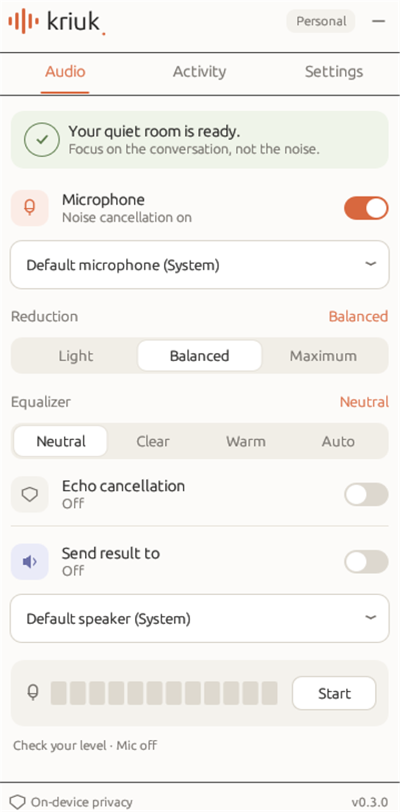

# Kriuk

[](https://github.com/Ilhamaji/kriuk/actions/workflows/build.yml)
[](https://github.com/Ilhamaji/kriuk/releases/latest)
[](LICENSE)
[](#requirements)

Tray audio utility for Windows that cleans your microphone: RNNoise denoising,
echo cancellation from the speaker loopback, and a voice equalizer — with a live
level meter and routing to any output device.

Pure Rust, one 5 MB executable: no Electron, no Node, no WebView2, no
background service, no account. The panel is drawn with `egui` in the same
process that runs the DSP. The chain keeps running in the tray, so it is still
cleaning your voice after the panel is hidden or closed.



▶ [15-second demo](docs/promo.mp4) — captions tell the story, so it works muted.

## Why

Most noise-suppression tools are subscriptions that push your voice through
someone else's server. Kriuk does the same job on the same machine that already
has your microphone: the DSP runs on the audio callback, the panel is drawn by
the same Rust binary, and nothing leaves the device.

## Features

| Feature | How it works |
|---|---|
| Mic noise cancellation | RNNoise (`nnnoiseless`) at 48 kHz, 10 ms frames, on the WASAPI audio thread |
| Reduction level | Light / Balanced / Maximum = 25 / 60 / 100 % wet mix |
| Echo cancellation | Partitioned block frequency-domain adaptive filter (`rustfft`), 4 partitions × 480 samples ≈ 40 ms, reference from a WASAPI loopback of the default output device, Geigel double-talk guard |
| Equalizer | RBJ biquads: Neutral (true bypass), Clear, Warm, and Auto, which measures the 300 Hz / 3 kHz band balance twice a second and tilts the curve, clamped to ±4–5 dB |
| Level meter | Peak level of the processed signal, 12 bars |
| Runs in the tray | The chain keeps running when the panel is hidden or closed; the tray tooltip reads *Kriuk — listening* while it does |
| Start with Windows | A `HKCU` Run entry that launches the app with `--hidden`, so signing in does not open the popover; the entry is rewritten on every launch, so moving the exe repairs it |
| Close to tray | Closing the window releases it (the GL surface goes with it) instead of quitting; **Quit** in the tray menu still exits |
| Send result to | Plays the processed audio on a chosen output device, including a virtual audio cable; a speaker on the microphone's own box is refused |
| Language | English by default, Indonesian available in Settings; the tray menu and tooltip follow the choice |
| Appearance | Light or dark, follows the system theme on first run |

Processing order: echo cancellation → denoiser → equalizer → meter / routing.
A disabled stage costs one atomic load per frame; no extra thread, no extra
stream.

## Quick start

1. Download [`Kriuk.exe`](https://github.com/Ilhamaji/kriuk/releases/latest/download/Kriuk.exe) and run it. The window is a popover anchored to the tray icon.
2. Pick a microphone and press **Start**; the meter shows the processed level.
3. Turn on **Echo cancellation** if your speakers leak into the mic, and pick an equalizer preset.
4. To feed another app (Zoom, Meet, Discord), set **Send result to** to a virtual cable such as VB-CABLE or VoiceMeeter, then choose that cable as the microphone in the other app. Windows has no way to inject audio into another app's mic without a virtual device.
5. Open **Settings** and turn on **Start with Windows** and **Close to tray**, so the chain is already running before your next call.

Hiding or closing the popover keeps the chain running — that is what makes it
usable during a call. The tray tooltip shows *Kriuk — listening* while the
microphone is open. Press **Stop**, or choose **Quit** in the tray menu, to
release it.

The last chain state, microphone, output device, language and theme are all
remembered: launch the app and it comes back listening on the same devices. If a
device disappears, the app falls back to the system default.

## Install

No installer. The file is the app: put it anywhere, run it, and deleting it
removes the app. There is no service and no driver. The only registry write is
the `HKCU\...\Run` entry that **Start with Windows** adds when you turn it on,
and turning the switch off deletes it.

The binary is not code-signed, so Windows SmartScreen shows "Windows protected
your PC" on first run — choose **More info → Run anyway**. A code-signing
certificate is the only way to remove that prompt.

Releases are built by GitHub Actions from the tag; see
[`.github/workflows/build.yml`](.github/workflows/build.yml).

## Requirements

- Windows 10 1809 or newer, or Windows 11
- No runtime to install: the panel is drawn with `egui` over OpenGL, so nothing
  beyond Windows is needed

## Performance

Measured on the development laptop (Windows 11, NVIDIA graphics):

| State | Private memory |
| --- | --- |
| In the tray, panel never opened | 2.4 MB |
| Panel open | ~57 MB |
| After the panel is closed | ~51 MB |

CPU is 0 % while idle and ~4.7 % while the chain is listening.

The panel is a real window that exists only while you are looking at it: closing
it destroys the window, the OpenGL surface and the egui context. The graphics
driver Windows keeps mapped afterwards is the difference between the last two
rows, and it goes away when you quit. Compare with a WebView2 panel, which holds
~170 MB from the first click until you quit.

The release profile uses LTO, one codegen unit, `panic = "abort"` and stripped
symbols, which is why the executable stays under 5 MB.

## Build

Requires Rust 1.77 or newer with the MSVC toolchain, plus Visual Studio Build
Tools with the Desktop C++ workload.

```powershell
cargo build --release --manifest-path src-tauri\Cargo.toml
```

The executable lands in `src-tauri\target\release\kriuk.exe`. There is no asset
step and no runtime to bundle: the panel is compiled into the binary.

## Tests

```powershell
cargo test --manifest-path src-tauri\Cargo.toml
```

The tests cover the DSP, not the UI: echo reduction of 10 dB or more across the
whole 40 ms filter span, double talk that does not swallow the local voice, and
every equalizer preset moving the band it claims to.

## Project layout

```
speaker loopback ──┐
                   ├─→ echo canceller ─→ RNNoise ─→ equalizer ─→ meter
microphone ────────┘                                            └→ output device
```

| Path | Purpose |
|---|---|
| `src-tauri/src/main.rs` | window and tray, panel placement, blur and close handling, autostart entry, cpal capture and monitor streams, loopback reference, chain state |
| `src-tauri/src/ui.rs` | the popover drawn with `egui`: rows, toggles, segmented controls, dropdowns, meter |
| `src-tauri/src/settings.rs` | the remembered chain, devices, language and theme in `%APPDATA%\Kriuk\settings.json` |
| `src-tauri/src/aec.rs` | PBFDAF echo canceller and its unit tests |
| `src-tauri/src/eq.rs` | biquad equalizer, presets, auto curve |
| `src/` | the HTML mock-up the demo video is rendered from; not part of the binary |
| `tools/make-icon.js` | generates the icon set without dependencies |
| `tools/serve.mjs`, `tools/render-promo.mjs`, `tools/build-video.mjs` | preview server and frame renderer for the demo video |
| `DESIGN.md` | visual specification |
| `REMAKE-RUST.md`, `REPORT.md` | reverse-engineering notes that led to this build |

## Troubleshooting

**No microphone in the list.** Windows blocks desktop apps from the mic unless
*Settings → Privacy → Microphone → Let desktop apps access your microphone* is
on. The list refreshes when you reopen the popover.

**The meter moves but the other app hears nothing.** *Send result to* must point
at the device the other app listens to — or at a virtual cable that the other
app uses as its mic. The chain only runs after **Start**; hiding the panel does
not stop it.

**The app quit when I closed the window.** *Settings → Close to tray* was off, so
the close really did exit. Turn it back on, or use **Quit** in the tray menu when
you do want to exit.

**Send result to refuses an output.** Two outputs are rejected on purpose. One is
the default speaker while echo cancellation is on: the canceller listens to that
device, so playing the processed mic there would make it subtract your own voice.
The other is a speaker that sits on the same box as the microphone — Windows names
those `Speakers (ME6S)` and `Microphone (ME6S)`, and the speaker is inches from
the capsule. That loop is acoustic, so no canceller can see it; the toggle shows
*The mic is on this device* instead of howling. A headset is exempt, because its
speaker sits on your ear.

**Echo is still there.** Echo cancellation can only subtract what the reference
device plays, and the reference is always the default output. A headset on a
different device gives it nothing to cancel, so monitoring the processed voice
there comes back through the mic as a hollow, comb-filtered copy. Use headphones
or a virtual cable for that output.

**SmartScreen blocks the download.** Expected for an unsigned binary: *More info
→ Run anyway*, or build it yourself.

## Privacy

No network code, no telemetry, no accounts, no audio written to disk. The
activity list in the app is in-memory and disappears when the app closes.

The microphone stays open while the chain runs, including when the panel is
hidden or closed — that is the point of the feature, and the tray tooltip is the
only indicator. **Stop** or **Quit** releases the device. Because the chain state
is restored on launch, an app that was listening when you closed it opens the
microphone again on the next start.

## Limitations

- Echo cancellation is validated on synthetic signals, not yet measured in a
  real room, and the loopback reference cannot model a speaker that is not the
  default output device. It also refuses to run while **Send result to** uses
  that same device, because it would cancel the voice instead of the echo.
- **Send result to** refuses an output that shares a box with the microphone, and
  cannot tell whether a speaker on another box is close enough to feed back. Use
  headphones or a virtual cable when the mic is live.
- Unsigned binary, so expect the SmartScreen prompt on first run.

## Contributing

Issues and pull requests are welcome. Keep the DSP covered by `cargo test`, and
run `cargo build --release` before opening a PR — CI builds and tests on
`windows-latest`.

## License

[MIT](LICENSE) © 2026 Ilhamaji
